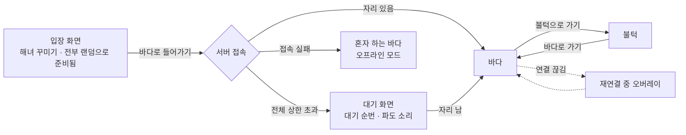
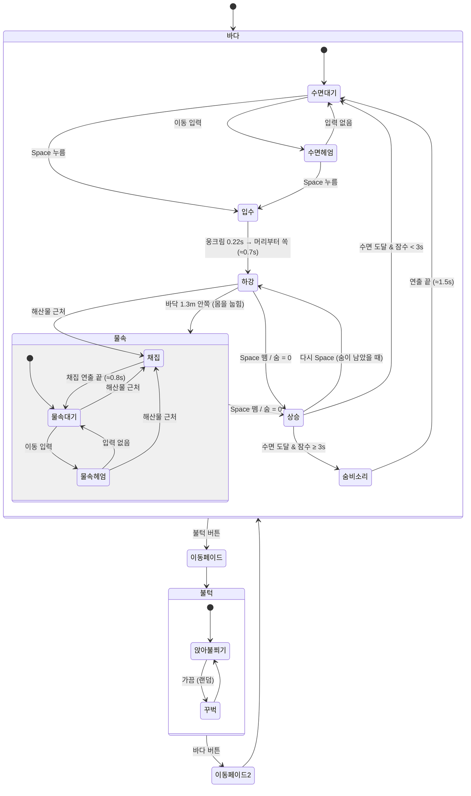

# 숨비 — 기획 문서 (PLAN)

> 웹 3D 해녀 힐링 공간. 가입 없이 들어와 제주 바다에서 물질하고, 불턱에서 함께 불을 쬐는 곳.
> 상태: v0.2 (2026-11-02) — 승인됨, 1단계 1차 구현 완료

---

## 1. 콘셉트와 타깃

### 한 줄 콘셉트
사용자는 귀여운 제주 해녀가 되어 바다에서 헤엄치고, 잠수해 해산물을 따고, 떠오르며 숨비소리("호오이~")를 낸다. 주변에는 다른 해녀들의 주황 테왁이 둥둥 떠 있고, 멀리서 그들의 숨비소리가 들린다. 물질을 마치면 불턱에 올라와 모닥불 주변에 함께 앉아 쉰다.

### 키워드
고요함 · 파도 소리 · 따뜻함 · 귀여움
**없는 것:** 경쟁, 랭킹, 채팅, 가입, 실패/페널티

### 타깃
- 퇴근 후·자기 전, 켜두고 멍하니 있고 싶은 20~30대 (산사·찜질방·한강 돗자리류 이용자)
- "혼자 있긴 외롭고, 대화는 귀찮은" 사람 → 말없이 곁에 누가 있다는 감각을 원함
- 제주·해녀 문화에 호감이 있는 사람 (설명보다는 분위기로 전달)

### 레퍼런스("온라인 산사")에서 가져오는 점
| 레퍼런스 요소 | 숨비에서의 적용 |
|---|---|
| 3인칭, 캐릭터 뒤를 부드럽게 따라오는 카메라 | 수면에선 약간 위에서, 물속에선 캐릭터 뒤 수평으로 따라옴 (감쇠 보간) |
| 사실적·부드러운 배경 + 장난감 같은 2~3등신 캐릭터 | 안개·빛줄기·부드러운 그림자의 바다 + 기본 도형으로 만든 큰 머리 해녀 |
| 머리 위 자동 닉네임 (형용사 + 자연 단어) | "느린 파도", "작은 소라", "고요한 물결", "따뜻한 돌담" |
| 상단 행동 알림 토스트 (채팅 대신 행동만) | "고요한 물결님이 숨비소리를 냈어요", "작은 소라님이 전복을 땄어요" |
| 가입 없이 바로 입장 | 입장 버튼 한 번 → 바로 바다. 닉네임은 브라우저에 기억 |

### 레퍼런스 이미지 분석 (산사 · 순례길 · 사우나 · 찜질방)
| 항목 | 관찰 | 숨비 적용 |
|---|---|---|
| 캐릭터 비율 | 머리 지름 ≈ 전체 키의 45~50%. 몸은 머리 아래 짧은 원통, 팔다리 아주 짧음. 얼굴은 점 눈(또는 감은 눈 곡선) + 분홍 볼 정도로 단순 | 머리 반지름 0.32 / 전체 키 ≈ 1.2 (머리 ≈ 52%). 점 눈, 볼 터치, 작은 입만 |
| 재질 | 광택 없는 소프트 비닐/점토 느낌, 파스텔·살구색 | `roughness 0.8~0.95`, 금속성 0. 잠수복도 순검정 대신 짙은 먹색 |
| 조명 | 따뜻한 주광 + 밝은 환경광, 그림자는 부드럽고 연함, 대비 낮음 | 반구광 비중 크게, 따뜻한 방향광, 부드러운 그림자, ACES 톤매핑 |
| 닉네임 | 머리 위 작은 알약(pill). 산사·순례길은 반투명 어두운 바탕 + 흰 글자, 사우나는 흰 바탕 + 검은 글자. **내 닉네임에는 "나" 동그라미 배지**, 또는 색 반전으로 구분 | 반투명 어두운 알약 + 흰 글자, 내 것은 "나" 배지. 거리 따라 작아짐 |
| 행동 알림 | 산사: 행동한 캐릭터 **머리 위**에 "합장으로 인사했어요" 말풍선 | 머리 위 말풍선("호오이~", "전복을 땄어요") + 다른 사람 행동은 상단 토스트에도 |
| 상단 | 순례길: 상단 가운데 조작 안내 알약 ("WASD·방향키로 걸어 다니고, 마우스로 끌어 둘러봐요") | 입장 직후 상단 가운데 조작 안내 → 10초 뒤 사라짐. 그 아래 행동 토스트 |
| 하단 | 산사: 하단 가운데 둥근 반투명 행동 바(합장/절하기/염주). 순례길: 하단 가운데 접히는 유리 카드("지금 188명이 같이 걷고 있어요", "오늘 다 같이 걸은 거리") | 하단 가운데 행동 바 [잠수 · 인사 · 불턱]. 왼쪽 아래 접히는 "오늘의 바다" 카드 |
| 카메라 | 순례길: 마우스로 끌어 둘러보기 | 마우스 드래그로 시점 회전, 휠로 줌, 이동은 카메라 기준. 움직이면 카메라가 천천히 등 뒤로 돌아옴 |

---

## 2. 첫 버전(MVP) 범위

### 포함
- **입장 화면**: 타이틀, 배정된 닉네임 미리보기, "바다로 들어가기" 버튼 (오디오 재생 허용을 위한 사용자 클릭 겸용)
- **바다 공간**: 수면(파도), 현무암 해안, 한라산 실루엣, 하늘. 물속 안개·빛줄기·현무암 바닥·해초·해산물(소라·전복·성게)
- **불턱 공간**: 둥근 현무암 돌담, 모닥불(불꽃·불빛 깜빡임·불티), 둘러앉는 자리
- **해녀 캐릭터**: 코드로 조합한 도형 모델 + 절차적 애니메이션 (헤엄, 잠수, 채집, 상승, 숨비소리, 인사, 앉아 불 쬐기)
- **조작**: PC 키보드 / 모바일 가상 조이스틱 + 잠수·인사 버튼
- **숨 게이지**: 잠수 중 감소, 0이 되면 자동 상승 (실패 연출 없음)
- **멀티플레이**: 방당 최대 50명, 위치 동기화(초당 10회), 행동 이벤트, 입·퇴장
- **화면 요소**: 닉네임, 행동 토스트, 오늘의 바다 집계, 내 채집 바구니, 바다↔불턱 버튼, 볼륨 조절(파도/숨비소리/효과음)
- **방 관리**: 꽉 차면 새 바다 생성, 전체 상한 초과 시 대기 화면

### 제외 (이후 버전 후보)
- 채팅, 이모지 반응, 친구·팔로우
- 계정·로그인, 기록 영구 저장(다른 기기 연동)
- 랭킹, 업적, 레벨, 상점·재화
- 캐릭터 커스터마이징 (테왁 색, 수건 무늬 등)
- 날씨·시간대 변화(실시간 제주 시간 연동 등), 계절 해산물
- 해안까지 헤엄쳐 걸어 올라가는 연속 이동 (MVP는 버튼 전환)
- 외부 3D 모델·텍스처 대량 사용, 후처리 효과 과다 사용
- 신고·차단 (채팅이 없어서 필요성 낮음. 닉네임은 서버가 생성하므로 욕설 위험 없음)

---

## 3. 화면 흐름



- **입장 화면 (꾸미기)**: 배경에 바다 장면이 이미 렌더링되어 있고, 내 해녀가 화면 빈 곳 가운데에 크게 떠서 천천히 몸을 돌린다. 모든 값이 랜덤으로 미리 정해져 있어 "바다로 들어가기"만 눌러도 된다. 다시 온 사람은 저장된 해녀로 짧은 카드만 보이고, "🎨 꾸미기"로 펼친다. 자세한 내용은 4.5.
- **바다**: 기본 공간. 수면 위에 떠서 시작.
- **불턱**: 버튼으로 이동 → 화면이 잠깐 하얗게/어둡게 페이드 → 불턱에서 빈자리에 자동으로 앉음.
- **대기 화면**: "바다가 붐벼요. 잠시 파도 소리를 들으며 기다려 주세요 (앞에 N명)". 자리가 나면 자동 입장.
- **오프라인 모드**: 서버에 못 붙어도 혼자 하는 바다는 그대로 동작 (1단계 결과물이 곧 이 모드).

---

## 4. 캐릭터와 동작

### 4.1 외형 (기본 도형 조합)
| 부위 | 도형 | 비고 |
|---|---|---|
| 머리 | 구 (지름 ≈ 몸의 1.2배) | 2~2.5등신. 살구색 피부, 볼 터치 |
| 수건/모자 | 머리 위쪽을 덮는 반구 + 작은 매듭 | 해녀 물수건 느낌, 흰색 또는 연회색 |
| 눈 | 작은 검은 구 2개 | 깜빡임(가끔 납작해짐) |
| 볼 | 분홍 납작 구 2개 | 숨비소리 때 크게 부풂 |
| 입 | 작은 원판/토러스 | 숨비소리 때 "오" 모양 |
| 물안경 | 토러스 2개 + 원판 렌즈 + 끈 | 평소 이마 위 → 잠수 시 눈 위로 내려옴 |
| 몸통 | 캡슐 (까만 잠수복) | 짧고 통통하게 |
| 팔 | 짧은 캡슐 2개 | 어깨 피벗으로 회전 |
| 다리 | 짧은 캡슐 2개 + 오리발(납작 원뿔) | 발차기 |
| 테왁 | 주황 구(약간 납작) + 아래 망사리(그물 주머니) | 평소 품에 안고 다님 |

- 재질은 `MeshStandardMaterial` 위주, 약간의 roughness로 장난감(소프트 비닐) 느낌.
- 부위별 그룹(`<group>`)을 피벗으로 두고 `useFrame`에서 회전·위치를 보간하는 **절차적 애니메이션** (외부 애니메이션 파일 없음).

### 4.2 동작 목록
| 동작 | 트리거 | 연출 | 네트워크 |
|---|---|---|---|
| 수면 대기 | 기본 | 테왁 안고 위아래로 둥실, 가끔 두리번 | — |
| 수면 헤엄 | 이동 입력 | 발차기, 몸 앞으로 기울임, 물보라 | 위치 |
| 잠수 시작 | Space 누름 / 잠수 버튼 | 물안경 내림 → 머리부터 거꾸로 입수, 테왁은 수면에 남김(안 1) | `dive` |
| 물속 헤엄 | 잠수 중 이동 | 평영 같은 팔다리 동작, 기포 | 위치 |
| 채집 | 해산물 근처 | 손 뻗기 → 해산물이 망사리로 쏙 | `harvest` |
| 상승 | Space 뗌 / 숨 0 | 위를 보며 발차기, 기포 많이 | `surface` |
| 숨비소리 | 수면 도달 시 자동 (일정 시간 이상 잠수했을 때) | 고개 젖힘, 볼 빵빵 → "호오이~" + 입김 | `sumbi` |
| 인사 | 숫자키 1 / 인사 버튼 | 한 손 흔들기 (다른 동작 위에 겹쳐 재생) | `wave` |
| 앉아 불 쬐기 | 불턱 입장 시 자동 | 앉아서 손을 불 쪽으로 내밀고 비빔, 가끔 꾸벅 | `sit` |
| 자리 옮기기 | 불턱 빈자리 누르기 (모바일은 탭) | 엉덩이 들며 일어나 기지개 → 가는 쪽으로 돌기 → 짧은 다리로 뒤뚱뒤뚱(좌우로 흔들, 테왁은 옆구리에) 모닥불 둘레로 → 모닥불 쪽으로 돌기 → 콩 뛰었다 털썩(납작 눌림·먼지·반짝) → 다시 불 쬐기 | `seat` |
| "앗" | 가려던 자리를 다른 사람이 먼저 잡음 | 그 자리 쪽으로 고개 돌리고 동그란 눈·입, 살짝 움찔 + 말풍선 "앗" | `seat_no` |
| 서서 불 쬐기 | 자리가 다 찼을 때 | 담 밖에 서서 손 쬐기. 자리가 나면 눌러서 입구로 들어와 앉음 | `stand` |
| 불턱 인사 | 숫자키 1 / 인사 버튼 | 앉은 채로 손 흔들기 | `wave` |
| 손질하기 | 불턱 손질 패널에서 해산물 아이콘 누르기 | 종류별 손질 모션 자동 재생 (5.3) → 공동 대야에 쏙 | `prep` |
| 함께 기뻐하기 | 자동: 공동 대야가 가득 차면 | 불턱의 모두가 만세하며 콩 뛰기 | `basin` (`full`) |
| 나눠주기 *(나중)* | 구운 소라를 들고 "나눠주기" | 옆 해녀에게 두 손으로 건넴, 받은 쪽은 호호 불어 먹기 | `share` |

### 4.3 숨 게이지
- 최대 숨: 30초 (조절 가능 상수). 잠수 중 감소, 수면에서 빠르게 회복 (약 3초에 가득).
- 숨이 0이 되면 자동 상승. 실패·기절 연출 없음 — 그냥 떠오르며 숨비소리.
- 남은 숨 20% 이하일 때 게이지가 부드럽게 깜빡이고 심장 박동 같은 저음 효과음 (볼륨 작게).

### 4.4 애니메이션 상태 다이어그램



**잠수 자세 (몸 전체 회전 = 몸통 그룹 pitch)**: 웅크림(뒤로 살짝, 몸 눌림) → 입수(머리가 아래로 약 76°, 이때 물보라·첨벙) → 하강(머리 아래 약 72°, 팔은 머리 위로 모으고 다리 파닥파닥) → 물속(엎드린 수평 자세, 개구리헤엄) → 상승(머리 위로 쭉 펴고) → 수면에서 퐁(늘어남·눌림). 자세 사이는 감쇠 보간으로 부드럽게 넘어간다. 입수하는 동안 카메라는 물 위에 머문다.

**겹쳐 재생되는 동작 (오버레이 레이어)**: `인사`, `눈 깜빡임`은 위 상태와 독립적으로 상체/얼굴에만 겹쳐 재생한다. 단, 입수·상승 중에는 인사 입력을 무시한다.

**원격 플레이어**: 위 상태 머신을 그대로 쓰되, 입력 대신 서버에서 받은 이벤트(`dive`, `surface`, `sumbi`, `harvest`, `wave`, `zone`)로 상태를 바꾸고 위치는 보간한다.

### 4.5 해녀 꾸미기 (입장 화면 · 바다 속 🎨 메뉴)
- **원칙**: 바로 입장이 가장 중요. 처음 방문 때 모든 값이 랜덤 → 바로 "바다로 들어가기" 가능. 고른 값은 브라우저(`localStorage: sumbi.custom`)에 저장, 다음 방문 때 그대로 입장. 다시 꾸미기는 입장 화면과 바다 속 오른쪽 위 🎨 버튼(수면에 있을 때만) 둘 다에서.
- **화면**: 데스크톱은 오른쪽 카드, 모바일 세로는 아래 시트(높이 최대 60%). 해녀는 패널이 가리지 않은 빈 곳의 가운데에 크게 (카메라 view offset + 거리 자동 조절), 대기 모션을 하며 좌우로 천천히 몸을 돌린다.
- **즉시 반영 + 반응**: 바꿀 때마다 바로 적용되고, 살짝 웅크렸다 콩 뛰며 두 팔을 번쩍, 눈웃음(≈0.75초).
- **항목** (목록은 `frontend/src/haenyeo/customize.ts`, 서버도 같은 목록으로 검증):

| 항목 | 선택지 |
|---|---|
| 물수건 | 파스텔 8색: 하양·하늘·분홍·노랑·민트·연보라·살구·연회색 |
| 테왁 | 6색, 따뜻한 주황 위주: 주황·귤빛·다홍·노을·호박·노랑 |
| 볼 | 4색: 분홍·복숭아·장밋빛·산호 |
| 잠수복 | 검정 고정 |
| 닉네임 | 앞말 36개 × 뒷말 36개 조합. 각각 목록에서 고르거나 🎲로 다시 뽑기 |
| 🎲 전부 랜덤 | 모든 항목을 한 번에 (지금 값과 다른 값으로) |

- **닉네임 단어**: 따뜻하고 차분한 말만, 부정적이거나 어느 뒷말과 붙어도 어색한 말은 넣지 않음. 앞말 예: 느린·고요한·포근한·몽글몽글한·노래하는 / 뒷말 예: 파도·소라·윤슬·동백·바당·숨비소리. 같은 닉네임이 여럿이어도 됨 (서버는 id로 구분).
- 키·동작 박자(사람마다 조금씩 다름)는 닉네임에서 계산.
- **프로토콜**: `hello`에 `nick`·`look`을 담아 보내고, 바다 속에서 바꾸면 `look` 메시지 (7장).

---

## 5. 공간 설계

### 5.1 바다
- 좌표: 수면 `y = 0`, 바닥 `y = -6 ~ -12` (해안 쪽이 얕음). 활동 반경 약 60m 원형, 경계에 가면 부드럽게 밀려남.
- **수면**: 커스텀 셰이더(사인파 합성)로 넘실거림 + 프레넬 반사 느낌. 캐릭터·테왁은 같은 파도 함수로 높이를 계산해 둥실거림.
- **하늘/조명**: 직접 만든 그라데이션 하늘(해·달·별) + 방향광(낮엔 해, 밤엔 달, 부드러운 그림자) + 반구광. 색·방향은 **실제 한국 시간**을 따름 (5.5).
- **해안**: 한쪽에 검은 현무암 바위 무리 (변형된 저폴리 구/정십이면체), 불턱 돌담이 멀리 보임.
- **한라산**: 아주 멀리 낮고 넓은 원뿔 실루엣, 안개로 흐리게.
- **물속**: 카메라가 `y < 0`이면 안개 색·밀도 전환(청록), 빛줄기(가산 블렌딩 반투명 원기둥), 바닥 커스틱(애니메이션 텍스처 또는 셰이더), 떠다니는 입자, 소리 먹먹하게(로우패스 필터).
- **해산물**: 소라·전복·성게를 도형으로 제작. 바닥 바위 주변에 흩어져 배치, 딴 자리는 20~40초 뒤 다시 생김.

### 5.2 불턱
- 지름 약 8m 원형 현무암 돌담(돌 여러 개 쌓기, 입구 하나), 가운데 모닥불.
- 자리: 안쪽 원 12자리 + 바깥 원 12자리 (넘치면 서서 쬐기 위치).
- 모닥불: 불꽃(위로 흔들리는 원뿔 몇 개 + 셰이더), 깜빡이는 점광원, 불티 입자, 장작 타는 소리.
- 하늘은 바다와 같은 시간대(5.5), 밤엔 모닥불이 더 밝고 멀리 비춤 + 멀리 파도 소리 (바다보다 작게).
- 실제 배치: 해안 위(`x=16`, 해안선에서 9m 안쪽), 입구는 바다 쪽. 대야는 모닥불에서 입구 쪽 1.32m. 자리는 서버가 가장 작은 빈 번호를 줌(0~11 안쪽 원, 12~23 바깥 원, 그 뒤는 담 밖에 둘러섬).
- 오가기: 수면에서 "불턱으로" → 화면이 부드럽게 가려졌다가 자리에 앉음. "바다로" → 불턱 아래 바닷가 수면.
- **자리 옮기기** (산사 자리 이동 방식): 빈 방석 돌에 마우스를 올리면 은은하게 빛나고 손가락 커서(앉아 있거나 누가 가는 중인 자리는 반응 없음), 누르면 서버에 요청 → 승인되면 일어나서 걸어가 앉음. 길은 안쪽 자리(반지름 2.05)와 바깥 자리(3.15) 사이 **걷는 고리(2.6)** 를 따라 짧은 쪽으로 돌고, 모닥불은 가로지르지 않음. 담 밖(서서 쬐는 자리)에서는 담 둘레로 입구까지 와서 들어옴. 걷는 속도 1m/s, 일어나기 0.55초·돌기 0.35초·도착해서 돌기 0.35초·앉기 0.55초. 걷다가 다른 빈자리를 누르면 그 자리에서 방향을 바꿈. 걷는 동안 손질·귤·졸기 버튼은 쉼.
- 모닥불 앞 가운데에 **공동 대야** 하나 + 모닥불 위 **석쇠**. 대야는 불턱에 있는 모두가 같은 상태를 봄.

### 5.3 불턱에서 해산물 손질하기 (4단계)
물질을 마친 해녀들이 모닥불에 둘러앉아, **내가 딴** 소라·전복·성게를 손질해 가운데 공동 대야에 모은다. 말은 없지만 같은 일을 나란히 하며 대야가 함께 차오르는 느낌이 핵심.

**조작 (단순하게)**
- 불턱에 앉으면 하단에 **손질 패널**이 뜸: 소라·전복·성게 아이콘 + 손질 가능 개수.
- 아이콘을 누르면 그 해산물 손질 모션이 **자동으로 끝까지 재생** (약 3초). 재생 중엔 다른 아이콘이 잠깐 비활성.
- 손질할 수 있는 것은 **오늘 내가 딴 것만**. 개수 = 딴 개수 − 이미 손질한 개수. 0이면 아이콘이 흐려지고 "바다에서 따 오세요" 안내.
- 바구니에서 사라지지 않음: `소라 5 (손질 3)`처럼 따로 셈.

**종류별 모션 (짧고 귀엽게, 도구는 도형 조합)**
| 해산물 | 도구 | 모션 (≈3초) | 토스트 |
|---|---|---|---|
| 소라 · 두드리기 | 작은 현무암 돌 | 무릎 위 소라를 톡톡톡 → 속살 쏙 꺼내 들어 보이기 | "○○님이 소라를 톡톡 두드렸어요" |
| 소라 · 굽기 *(나중)* | 모닥불 석쇠 | 석쇠에 올림 → 지글지글 + 김이 모락모락 → 집어 들고 호호 불기 | "○○님이 소라를 구웠어요" |
| 전복 | 빗창 (작은 납작 칼) | 껍데기 밑에 빗창을 밀어 넣어 "뽁" 떼어냄 → 반짝이는 껍데기를 불빛에 비춰 봄 | "○○님이 전복을 떼어냈어요" |
| 성게 | 숟가락 | 반으로 쩍 → 노란 알을 숟가락으로 살살 → 한 입 맛보고 볼 빵빵 + 초승달 눈 | "○○님이 성게 알을 꺼냈어요" |

- 모션이 끝나면 손질한 해산물이 포물선을 그리며 **공동 대야에 쏙** → 대야 수면이 조금 올라가고 "톡" 소리.
- 내 행동은 머리 위 말풍선, 다른 사람 행동은 상단 토스트 (토스트 규칙대로 합치고 줄임).

**공동 대야**
- 불턱(방 단위)마다 대야 하나. 정원 `capacity`개가 차면 가득 참.
- 손질 하나가 끝날 때마다 `fill + 1` → 대야 속 해산물 더미 높이가 올라감.
- **가득 차면**: 그때 불턱에 있는 해녀 모두가 함께 **만세하며 콩 뛰고**, 대야 위로 반짝이·물방울이 튐 + 짧은 축하 소리. 연출이 끝나면 대야를 비우고 다음 대야 시작(`round + 1`).
- `capacity` 기본 20. 사람이 적어도 너무 오래 걸리지 않게, 비울 때 그 순간 불턱 인원에 맞춰 조절(예: `clamp(인원 × 4, 12, 40)`).

**나눠주기 *(나중)***
- 구운 소라를 들고 있을 때 아이콘 대신 **"나눠주기"** 버튼이 뜸 → 양옆 자리 중 가까운 해녀에게 자동으로 건넴 (대상 선택 UI 없음).
- 건네는 쪽은 두 손으로 내밀고, 받는 쪽은 자동으로 받아서 호호 불어 먹고 볼 빵빵.
- 토스트: "○○님이 △△님에게 구운 소라를 건넸어요".

**쉬기 (불턱에서만)**
- 🍊 **귤 까먹기**(T, 4초): 껍질을 까서 한 쪽씩 오물오물. 토스트 "○○님이 귤을 까먹어요".
- 😴 **꾸벅꾸벅 졸기**(Z): 고개를 끄덕이며 머리 위에 zzz. 다시 누르거나 다른 행동을 하면 깸. 나중에 들어온 사람에게도 조는 모습 그대로(`st: "doze"`).

**범위 나누기 (4단계 안에서 하루이틀 일정)**
| 구분 | 내용 |
|---|---|
| **최소 범위 (1~2일)** ✅ | 손질 패널(아이콘 3개 + 개수) · 소라 두드리기 / 전복 빗창 / 성게 알 긁기 + 맛보기 모션 3종 · 도구 3개(돌, 빗창, 숟가락) · 공동 대야 차오름 + 가득 차면 모두 만세 · 손질 토스트 · `prep` / `basin` 메시지 · 서버의 "내가 딴 것만" 검증 |
| **나중에** | 소라 석쇠 굽기(김 모락모락) · 구운 소라 나눠주기 · 옆 사람이 손질을 마치면 끄덕이는 맞장구 · 손질 소리 다양화 · "오늘 대야 N번 가득 찼어요" 집계 · 대야 꾸미기(해초 장식 등) |

### 5.4 숨 고르기 → 삭제 (2026-11-03)
- 4단계에 넣었던 숨 고르기(B, 4초 들이쉬고 6초 내쉬기, 숨 최대치 보상, 다른 해녀 둘레 빛)는 **삭제하고 "둥둥"으로 대체**.
- 이유: 힐링 요소를 '해야 하는 것(호흡 따라 하기·보상 쌓기)'이 아니라 **'하지 않아도 되는 것'** 으로 단순화. 아무것도 안 하고 멍때리는 사람을 위한 자리로 바꿈.

### 5.4+ 둥둥 — 물 위에 누워 하늘 보기 (2026-11-03)
아무것도 하지 않고 멍때리는 사람을 위한 모드. 점수·보상 없음.
- **시작/끝**: 행동 바의 ☁️ 둥둥 버튼(숨 고르기 자리) 또는 **F**. 바다 수면에 떠 있을 때만(잠수 중엔 꺼짐, 불턱에선 버튼이 없음). 테왁을 배 위에 끌어안고 천천히 뒤로 누움(해달처럼, 고개를 살짝 들어 테왁을 바라봄), 다리는 살짝 떠서 가끔 발끝을 까딱. 버튼을 다시 누르거나(일어나기) 이동 키를 누르면 몸을 뒤집어 다시 떠 있는 자세. 누워 있는 동안 잠수 안 됨, 숨 게이지 숨김, 인사 안 됨, 불턱으로 못 감.
- **몸**: 파도 따라 오르내리고 살짝 기울어짐, 아주 느리게 떠내려감(바다 범위·얕은 곳은 피함), 몸도 천천히 돌아감. 4~10초마다 눈 감았다 뜨기·하품·테왁 고쳐 안기·발끝 까딱.
- **카메라**: 누우면 천천히 수면 가까이 내려가 발 쪽에서 올려다봄 — 화면 아래에 얼굴과 테왁이 살짝, 나머지는 하늘. 시선은 머리를 기준으로 잡아서 몸이 돌아가도 구도가 유지됨. 끌기로 하늘 둘러보기, 휠로 시야 넓히기·좁히기. 2.5초 동안 손대지 않으면 천천히 기본 구도로. 일어나면 2초쯤 걸쳐 등 뒤 시점으로.
- **누울 방향**: 밤엔 달 쪽, 새벽·노을엔 해 쪽(물든 하늘), 낮엔 해를 등지게(눈부시지 않게) 머리를 둠.
- **하늘** (실제 시간을 따름. 누워 있는 동안 시간대가 바뀌면 하늘도 천천히):
  - 구름: 낮은 폴리곤 몽글한 구름 모양 4가지 × 8개(인스턴싱), 바람 따라 흐르고 내 둘레를 감싸 돌아서 어디서 올려다봐도 있음. 노을엔 해 쪽 면과 아랫면이 주황, 윗면은 분홍보라, 밤엔 어둡게. (둥둥이 아닐 때도 하늘에 있음)
  - 노을: 주황 지평선과 남색 하늘 사이 보랏빛 띠 (해 쪽이 더 진하게).
  - 밤: 별 2,400개(Points 한 묶음, 밝기·크기·색이 저마다, 천천히 반짝), 은은한 은하수 띠, 달. 별마다 나타나는 문턱이 달라 새벽엔 하나씩 사라지고 저녁엔 하나씩 돋아남.
  - 낮(둥둥 중): 22~48초마다 갈매기 한두 마리가 날갯짓·활공하며 하늘을 가로지르고, 가까이 올 때 멀리서 끼룩 (좌우 방향).
  - 밤(둥둥 중): 45~115초마다 별똥별. 화면 안에서 떨어지면 "별똥별이 떨어졌어요"를 잠깐 띄우고 일지에 남김.
- **소리**: 귀가 물에 잠긴 느낌 — 파도는 가깝고 부드럽게(밤엔 더 조용히), 숨비소리·효과음은 먹먹하게. 다른 해녀의 숨비소리는 아주 멀리서 들리듯 작게.
- **UI**: 4.5초 동안 손대지 않으면 UI(머리 위 이름표 포함)가 천천히 사라져 하늘만. 마우스·터치·키·휠이면 다시 나타남. 사라져도 오른쪽 아래 "일어나기" 버튼만 은은하게 남음. 누워 있는 동안 내 이름표는 숨김.
- **멀티플레이**: `act float` / `float_end` 로 시작·끝만 방송, 다른 사람에겐 테왁을 안고 누운 해녀로 보임(나중에 들어온 사람도 `st: "float"`). 누운 해녀 머리 위에 13초마다 3초쯤 ☁️(낮)·✨(밤). 상단 토스트는 띄우지 않음.
- **물질 일지**: "둥둥 · 하늘을 12분 바라봤어요"(1분 미만이면 "잠깐"), 별똥별을 봤으면 "밤하늘 · 별똥별을 봤어요". 줄이 6개면 줄 간격 58.
- **성능**: 별은 Points 하나(그리기 1번), 구름은 모양별 인스턴싱(4번), 갈매기 2마리·별똥별 1개는 만들어 두고 돌려 씀. 물속에선 별·구름을 끔.
- 개발용: 콘솔 `__sumbi.float.start()` / `.stop()`, `__sumbi.float.cam`(둘러보기 각도), `__sumbi.float.view`(구도 값), `__sumbi.gulls()`, `__sumbi.shootingStar()`.

### 5.5 실제 시간 바다 (4단계)
- 한국 시간을 따라 **새벽·낮·노을·밤**: 시각별 키프레임(밤 → 여명 5.5시 → 해돋이 6.5시 → 낮 8.5~16시 → 황금빛 17.6시 → 노을 18.6시 → 땅거미 19.5시 → 밤 20.4시)을 섞은 값 하나(`env`)를 하늘·빛·안개·물빛·물속이 함께 읽음.
- 해는 6시쯤 동쪽에서 떠서 남쪽 하늘을 지나 18시 반쯤 서쪽으로. 밤엔 바다 쪽 하늘에 달 → 수면에 **달빛 길**, 별이 반짝임.
- 밤 물속: 푸른 **플랑크톤**이 가물거리고, 헤엄치면 지나간 자리에 빛이 흩어짐. 빛줄기·떠다니는 입자는 흐리게.
- 시간대 사이는 부드럽게 섞임. 개발용 고정: `?time=dawn|day|sunset|night`, `?hour=21.5`, 콘솔 `__sumbi.setTime('night')` (바꾸면 사이 시간을 몇 초에 걸쳐 지나감).

### 5.6 물질 일지 (4단계)
- 상단 "📔 물질 마치기" → 이번 물질을 정리한 **한 장짜리 카드**(1080×1350): 위엔 내 해녀를 앞에서 찍은 지금 시간대 풍경, 아래엔 "오늘 바다에 23분 머물렀어요"와 숨비소리 · 딴 해산물 · 손질한 것 · 함께한 해녀 수, 시간대별 마무리 한 줄.
- **이미지로 저장**: 휴대폰은 공유 시트(사진 앱에 저장), PC 는 PNG 내려받기.
- "계속 물질하기" / "바다 떠나기"(연결을 끊고 입장 화면, 다시 들어오면 새 물질).
- 기록은 **브라우저에만** (`sumbi.journal`, 최근 60개). 탭을 닫아도 그때까지의 기록은 남김. 서버로 보내지 않음.

---

## 6. 프론트엔드

### 6.1 주요 라이브러리
| 용도 | 선택 | 이유 |
|---|---|---|
| 3D | `three`, `@react-three/fiber`, `@react-three/drei` | 요구사항 |
| 상태 관리 | `zustand` | R3F 생태계 표준, `useFrame` 안에서 리렌더 없이 읽기 쉬움 |
| 후처리 (선택) | `@react-three/postprocessing` | 약한 비네트·블룸 정도만. 모바일에서는 끔 |
| 사운드 | Web Audio API 직접 사용 | 채널별 볼륨(GainNode), 물속 로우패스, 원격 숨비소리 거리 감쇠 |
| 모바일 조이스틱 | 직접 구현 (포인터 이벤트) | 의존성 최소화 |

### 6.2 폴더 구조
```
frontend/
├─ index.html
├─ vite.config.ts
├─ public/
│  ├─ sounds/            # sumbi.mp3, sumbi-2.mp3, waves.mp3 ... (없으면 합성음으로 대체)
│  └─ fonts/             # 닉네임용 한글 폰트 서브셋
└─ src/
   ├─ main.tsx
   ├─ App.tsx                    # 화면 전환 (입장 / 대기 / 게임)
   ├─ config.ts                  # 상수: 숨 시간, 속도, 송신 주기, 서버 주소
   ├─ screens/
   │  ├─ EntryScreen.tsx
   │  ├─ WaitingScreen.tsx
   │  └─ GameScreen.tsx          # <Canvas> + HUD
   ├─ world/
   │  ├─ sea/
   │  │  ├─ SeaScene.tsx
   │  │  ├─ Ocean.tsx            # 수면 셰이더
   │  │  ├─ waves.ts             # 파도 높이 함수 (셰이더와 JS 공용)
   │  │  ├─ SkyAndLight.tsx
   │  │  ├─ Coast.tsx            # 현무암 해안
   │  │  ├─ Hallasan.tsx
   │  │  ├─ Seabed.tsx           # 바닥, 바위, 해초
   │  │  ├─ Underwater.tsx       # 안개 전환, 빛줄기, 커스틱, 입자
   │  │  └─ seafood/
   │  │     ├─ SeafoodField.tsx  # 배치·리스폰
   │  │     ├─ Conch.tsx  Abalone.tsx  Urchin.tsx
   │  └─ bulteok/
   │     ├─ BulteokScene.tsx
   │     ├─ StoneWall.tsx
   │     ├─ Campfire.tsx
   │     └─ seats.ts             # 자리 좌표
   ├─ haenyeo/
   │  ├─ Haenyeo.tsx             # 외형 조립 (로컬/원격 공용)
   │  ├─ parts/                  # Head, Goggles, Body, Arms, Legs, Tewak, Mangsari
   │  ├─ stateMachine.ts         # 상태와 전이 규칙 (순수 TS, 테스트 가능)
   │  ├─ poses.ts                # 상태별 목표 포즈
   │  └─ useHaenyeoAnimation.ts  # 포즈 보간 + 오버레이(인사, 깜빡임)
   ├─ player/
   │  ├─ LocalPlayer.tsx         # 입력 → 이동·상태 → 송신
   │  ├─ FollowCamera.tsx
   │  ├─ useBreath.ts
   │  └─ input/
   │     ├─ useKeyboardInput.ts
   │     └─ touchInput.ts        # 조이스틱·버튼 상태 공유
   ├─ remote/
   │  ├─ RemotePlayers.tsx
   │  ├─ RemotePlayer.tsx
   │  └─ interpolation.ts        # 스냅샷 버퍼 보간 (약 150ms 지연)
   ├─ net/
   │  ├─ protocol.ts             # 메시지 타입 정의 (백엔드와 1:1)
   │  ├─ NetClient.ts            # 인터페이스
   │  ├─ OfflineNetClient.ts     # 1~2단계: 혼자 하는 바다 (가짜 서버)
   │  └─ WsNetClient.ts          # 3단계: WebSocket, 재연결, 송신 주기 제한
   ├─ audio/
   │  ├─ AudioEngine.ts          # 채널(파도/숨비/효과음) GainNode, 물속 필터
   │  └─ sounds.ts
   ├─ ui/
   │  ├─ Hud.tsx
   │  ├─ ActionToasts.tsx
   │  ├─ TodaySea.tsx            # 오늘의 바다
   │  ├─ Basket.tsx              # 내 채집 바구니
   │  ├─ BreathGauge.tsx
   │  ├─ ZoneButton.tsx          # 바다 ↔ 불턱
   │  ├─ VolumePanel.tsx
   │  ├─ NameTag.tsx             # 머리 위 닉네임
   │  └─ mobile/
   │     ├─ Joystick.tsx
   │     └─ ActionButtons.tsx    # 잠수, 인사
   ├─ store/
   │  ├─ gameStore.ts            # 나, 원격 플레이어, 구역, 바구니, 오늘 집계
   │  ├─ toastStore.ts
   │  └─ settingsStore.ts        # 볼륨 (localStorage 저장)
   └─ lib/
      ├─ nickname.ts             # 무작위 닉네임 (개발용 가짜 이웃)
      └─ math.ts
```

### 6.3 설계 원칙
- **네트워크 추상화**: 게임 코드는 `NetClient` 인터페이스만 안다. 1~2단계는 `OfflineNetClient`(로컬 집계·토스트를 흉내), 3단계에서 `WsNetClient`로 갈아끼운다. 테스트용으로 가짜 원격 해녀(봇) 몇 명을 띄우는 기능도 여기에 둔다.
- **매 프레임 데이터는 React 상태에 넣지 않는다**: 위치·회전은 `ref`와 zustand의 비반응 접근(`getState()`)으로 처리, React 리렌더는 UI 변화(토스트, 바구니 개수 등)에만.
- **닉네임 표시 비용**: 50명 전원 HTML 라벨은 무겁다 → drei `Text`(한글 폰트 서브셋) 또는 가까운 15명만 표시.
- **토스트 홍수 방지**: 50명이 동시에 행동하면 토스트가 넘친다 → 최대 3개 표시, 1.2초 간격, 오래된 것 버림, 같은 사람 연속 행동은 합침. 내 행동은 토스트 대신 작은 효과로.
- **모바일 성능**: 픽셀 비율 상한(≤1.5), 그림자 해상도 낮춤, 후처리 끔, 입자 수 줄임.

---

## 7. WebSocket 메시지 프로토콜

### 7.1 공통 규칙
- 순수 WebSocket, 텍스트 프레임, JSON. 모든 메시지에 `t`(타입) 필드.
- 주소: `wss://<도메인>/ws`
- 위치는 소수 둘째 자리까지 반올림 (`[x, y, z]`), 방향은 yaw 라디안 하나.
- 클라이언트 위치 송신: **초당 10회 상한**, 움직임이 거의 없으면 초당 1회로 줄임.
- 서버: 받은 위치를 바로 중계하지 않고 **방 단위로 모아 초당 10회 스냅샷**으로 방송 (메시지 수 50×50 → 50으로 감소).
- 상태 변화는 즉시 이벤트로 전송·방송.
- 플레이어 id는 방 안에서만 쓰는 짧은 정수.

### 7.2 클라이언트 → 서버

**hello** — 접속 직후 1회
```json
{
  "t": "hello", "v": 1, "token": "b3f1…(이전에 받은 값, 없으면 생략)", "device": "pc",
  "nick": { "adj": "몽글몽글한", "noun": "돌고래" },
  "look": { "towel": "pink", "tewak": "yellow", "cheek": "rose" }
}
```
`nick`·`look`은 입장 화면에서 고른 값 (4.5). 목록에 없는 값이면 서버가 그 항목만 랜덤으로 바꿔 `welcome`으로 알려 준다.

**look** — 바다 속 🎨 메뉴에서 꾸미기를 바꾸고 "완료"했을 때
```json
{ "t": "look", "nick": { "adj": "느린", "noun": "파도" }, "look": { "towel": "mint", "tewak": "orange", "cheek": "pink" } }
```

**move** — 위치 (≤10Hz)
```json
{ "t": "move", "p": [12.34, -3.2, -8.71], "r": 1.57 }
```

**act** — 행동 이벤트
```json
{ "t": "act", "a": "dive" }
{ "t": "act", "a": "surface" }
{ "t": "act", "a": "sumbi" }
{ "t": "act", "a": "wave" }
{ "t": "act", "a": "harvest", "item": "abalone" }
{ "t": "act", "a": "tangerine" }     // 귤 까먹기 (불턱에서만)
{ "t": "act", "a": "doze" }          // 졸기 (불턱에서만)
{ "t": "act", "a": "wake" }
{ "t": "act", "a": "float" }         // 둥둥: 물 위에 눕기 (바다 수면에서만)
{ "t": "act", "a": "float_end" }     // 둥둥: 일어나기
```
바다 행동(`dive`·`surface`·`sumbi`·`wave`·`harvest`·`float`·`float_end`)은 바다에서만, 불턱 행동(`wave`·`tangerine`·`doze`·`wake`)은 불턱에서만 받아들임.

**prep** — 손질 시작 (4단계, 불턱에 앉아 있을 때만)
```json
{ "t": "prep", "item": "urchin" }
{ "t": "prep", "item": "conch", "how": "grill" }
```
`how`: `tap`(기본, 소라 두드리기) | `grill`(나중, 소라 굽기). 모션 길이(3초, 서버 `sumbi.bulteok.prep-ms` = 프론트 `prepDuration`)는 클라이언트가 재생하므로 시작만 보낸다. 손질할 게 없으면 본인에게 `err NO_ITEM`.

**share** — 구운 소라 나눠주기 *(나중)*
```json
{ "t": "share" }
```
받는 사람은 서버가 정함 (양옆 자리 중 앉아 있는 사람).
`item`: `conch`(소라) | `abalone`(전복) | `urchin`(성게)

**zone** — 바다 ↔ 불턱 이동 (불턱은 수면에 있을 때만, 0.5초에 1번까지)
```json
{ "t": "zone", "to": "bulteok" }
{ "t": "zone", "to": "sea" }
```

**seat** — 불턱에서 이 자리로 옮겨 앉고 싶음 (요청만. 서버가 승인하면 그때 움직임)
```json
{ "t": "seat", "seat": 6 }
```
`seat`: 0~23 (앉는 자리). 걷는 중에 보내면 방향 바꾸기.

**ping**
```json
{ "t": "ping", "ts": 1730530000123 }
```

### 7.3 서버 → 클라이언트

**queue** — 전체 상한 초과 시 대기
```json
{ "t": "queue", "ahead": 12 }
```

**welcome** — 입장 성공
```json
{
  "t": "welcome",
  "you": { "id": 7, "nick": "몽글몽글한 돌고래", "token": "b3f1…", "look": { "towel": "pink", "tewak": "yellow", "cheek": "rose" }, "p": [2.1, 0, 10.3] },
  "room": { "id": "sea-3", "capacity": 50 },
  "players": [
    { "id": 2, "nick": "작은 소라", "look": { "towel": "sky", "tewak": "orange", "cheek": "peach" }, "zone": "sea", "p": [3.1, 0, -4.2], "r": 0.4, "st": "surface" },
    { "id": 5, "nick": "따뜻한 돌담", "look": { "towel": "white", "tewak": "amber", "cheek": "pink" }, "zone": "bulteok", "seat": 4, "st": "sit" }
  ],
  "today": { "divers": 128, "items": { "conch": 342, "abalone": 97, "urchin": 210 } }
}
```
`you.p`: 서버가 정해 준 시작 위치(여럿이 겹치지 않게 시작점 주변에 흩어 놓음). 재접속이면 클라이언트는 지금 위치를 유지.
`st`(현재 상태): `surface` | `underwater` | `sit` | `doze`(불턱에서 조는 중) — 중간 입장자가 다른 사람의 모습을 맞추기 위한 값. 불턱 사람은 `p`·`r` 대신 `seat`.

**join / leave**
```json
{ "t": "join", "player": { "id": 9, "nick": "고요한 물결", "look": { "towel": "mint", "tewak": "scarlet", "cheek": "coral" }, "zone": "sea", "p": [0, 0, 0], "r": 0, "st": "surface" } }
{ "t": "leave", "id": 9 }
```

**look** — 누군가 꾸미기를 바꿈 (같은 방에 방송)
```json
{ "t": "look", "id": 9, "nick": "느린 파도", "look": { "towel": "mint", "tewak": "orange", "cheek": "pink" } }
```

**snap** — 위치 스냅샷 (10Hz, 같은 구역의 움직인 사람만)
```json
{ "t": "snap", "ts": 1730530000200, "ps": [[2, 3.12, 0, -4.25, 0.41], [9, 0.5, -2.1, 1.0, 3.02]] }
```
`ps` 각 항목: `[id, x, y, z, yaw]`

**evt** — 행동 방송 (토스트·애니메이션용)
```json
{ "t": "evt", "id": 9, "a": "sumbi" }
{ "t": "evt", "id": 2, "a": "harvest", "item": "abalone" }
{ "t": "evt", "id": 5, "a": "wave" }
{ "t": "evt", "id": 5, "a": "doze" }
```
`a` 는 7.2 의 act 와 같음 (보낸 사람 빼고 같은 방에 방송). `st` 는 `surface`·`underwater`·`float`(둥둥 중)·`sit`·`doze`.

**prep** — 누군가 손질을 시작함 (본인 포함, 같은 불턱에 방송). 모두가 그 해녀 자리에서 같은 모션을 재생
```json
{ "t": "prep", "id": 5, "item": "urchin", "how": "tap", "left": 2 }
```
`left`: 그 사람이 앞으로 손질할 수 있는 개수 (본인 패널 표시용)

**basin** — 공동 대야 상태. 불턱 입장 시 1회 + 손질이 대야에 들어갈 때마다 (모션 길이만큼 지연 후)
```json
{ "t": "basin", "fill": 13, "capacity": 20, "round": 4 }
{ "t": "basin", "fill": 20, "capacity": 20, "round": 4, "full": true }
{ "t": "basin", "fill": 0, "capacity": 24, "round": 5 }
```
`full: true`를 받으면 불턱의 모두가 함께 기뻐하는 모션 → 몇 초 뒤 서버가 비운 대야(`round + 1`)를 보냄

**share** — 나눠주기 *(나중)*
```json
{ "t": "share", "from": 5, "to": 9 }
```

**zone** — 누군가 구역을 옮김 (본인 포함)
```json
{ "t": "zone", "id": 7, "zone": "bulteok", "seat": 11 }
{ "t": "zone", "id": 7, "zone": "bulteok", "seat": 11, "left": { "conch": 2, "abalone": 1, "urchin": 0 } }
{ "t": "zone", "id": 7, "zone": "sea", "p": [16.9, 0, -24.9] }
```
본인에게 가는 불턱 `zone` 에만 `left`(손질할 수 있는 개수)가 붙고, 바로 뒤에 지금 `basin` 이 옴. 바다로 돌아갈 때 `p` 는 서버가 정한 불턱 아래 수면 자리. 재접속했는데 불턱에 있었다면 `welcome` 뒤에 `zone`·`basin` 을 다시 보냄.

**seat** — 누군가 자리를 옮기기 시작함 (본인 포함, 방 전체). 위치는 보내지 않고, 각 화면이 `from` → `to` 같은 길을 같은 걸음으로 재생
```json
{ "t": "seat", "id": 7, "from": 0, "to": 6 }
```
`from` 은 지금까지의 자리(걷던 중이면 가던 자리, 24 이상이면 담 밖). 받는 즉시 `from` 은 빈자리, `to` 는 걷는 동안에도 그 해녀 자리.

**seat_no** — 그 자리는 이미 누가 있거나 가는 중 (요청한 본인에게만). 받으면 "앗" 하고 그대로 (걷던 중이면 가던 자리로 계속)
```json
{ "t": "seat_no", "seat": 6 }
```

**today** — 오늘의 바다 갱신 (변화가 있을 때 최대 5초에 1회)
```json
{ "t": "today", "divers": 129, "items": { "conch": 343, "abalone": 97, "urchin": 211 } }
```

**pong / err**
```json
{ "t": "pong", "ts": 1730530000123 }
{ "t": "err", "code": "RATE_LIMIT", "msg": "too many messages" }
{ "t": "err", "code": "NO_ITEM", "msg": "harvest it in the sea first" }
```

### 7.4 서버 검증 (가볍게)
- 메시지 크기 제한(1KB), 연결당 초당 메시지 수 제한(30).
- 위치: 이전 위치 대비 비정상 순간이동은 잘라냄, 바다 경계 밖 좌표 보정.
- 둥둥: `float` 는 수면에 떠 있고 아직 눕지 않았을 때만, `float_end` 는 누워 있을 때만. `dive` 하거나 불턱으로 가면 저절로 일어난 것으로 침.
- 채집: 잠수 상태일 때만 인정, 1인당 최소 간격(예: 1초). 랭킹이 없으므로 그 이상 검증은 하지 않음.
- 손질: 불턱에 앉아 있고, 그 종류의 `오늘 딴 개수 − 손질한 개수 > 0`일 때만 인정 ("내가 딴 것만"). 서버가 재접속 토큰별로 오늘(KST) 딴/손질한 개수를 기억(`PrepLedger`, 메모리). 진행 중인 손질·귤 까먹기가 끝나기 전 새 `prep`은 무시.
- 대야: 손질이 **끝나는 시각**에 `fill + 1`. 가득 찬 뒤 축하(4초) 동안 끝난 손질은 다음 대야로 넘김. 다음 대야 크기 = `clamp(불턱 인원 × 4, 12, 40)`.
- 불턱에 있는 동안 `move` 는 무시하고 스냅샷에서도 뺌 (자리에 앉아 있으므로).
- 자리 옮기기: 자리 확인과 배정을 **방 잠금 안에서 한 번에** 하므로 같은 자리를 거의 동시에 눌러도 먼저 온 요청만 승인 (나머지는 `seat_no`). 0~23 만, 손질·귤 까먹기 중엔 거절. 승인하면 원래 자리는 바로 비우고, 걷는 시간(`SeatPath`, 프론트 `seatWalk.ts` 와 같은 공식) 동안 손질·귤·졸기를 거절. 걷는 중 연결이 비정상으로 끊기면 바로 바다로 보내 목적지 자리를 비움 (앉아 있다 끊기면 20초 유예 동안 자리 유지).
- 닉네임·꾸미기: 앞말·뒷말·색 id가 공유 목록(`customize.ts`와 같은 값)에 있는지만 확인. 중복 닉네임 허용. `look`은 1인당 2초에 1번까지.
- 30초 동안 아무 메시지가 없으면 연결 정리 (클라이언트는 10초마다 ping).

---

## 8. 백엔드

### 8.1 구성
- Spring Boot 3, Java 21, `spring-boot-starter-websocket` (STOMP 없이 `TextWebSocketHandler`)
- JSON: Jackson, 메시지는 `record` + `sealed interface`로 타입 정의
- 동시성: 방(Room) 메서드를 `synchronized` 로 묶음 (3단계 구현. 방마다 단일 스레드 큐보다 단순하고 50명 규모엔 충분, 필요하면 나중에 교체). 송신은 연결마다 **보낼 줄 + 전송 가상 스레드 하나**(`ClientConnection`): 방 잠금 안에서는 줄에 넣기만 하고(순서 보장, 네트워크 대기 없음), 실제 전송은 잠금 밖 전송 스레드가. 전송 하나가 3초를 넘거나 못 보낸 양이 256KB를 넘으면 그 연결만 끊음(재접속 유예). 빈 바다는 닫고(`closeIfEmpty`) 닫힌 바다는 입장을 거절, 입장·퇴장·대기열 입장은 `GameServer` 한 잠금. 잠금 순서는 언제나 GameServer → RoomManager → Room.
- 스케줄러: 방별 100ms 틱에 스냅샷 방송
- 집계: Redis (`sumbi:today:<KST 날짜>:divers` SET · `:items` HASH · `:ver`, 쓰기·만료·버전 증가를 Lua 하나로, 48시간 TTL). `SUMBI_STATS_STORE=auto` 면 Redis 가 없거나 멈췄을 때 메모리로 자동 전환(30초마다 재시도, 명령 제한 500ms)

### 8.2 패키지 구조
```
backend/src/main/java/com/sumbi/
├─ SumbiApplication.java
├─ config/
│  ├─ WebSocketConfig.java          # /ws 등록, 허용 Origin
│  └─ SumbiProperties.java          # 방 정원, 전체 상한, 틱 주기 등
├─ ws/
│  ├─ SumbiWebSocketHandler.java    # 연결/종료/메시지 수신 → 디스패치
│  ├─ ClientConnection.java         # 세션 + 송신 래퍼 + 속도 제한
│  └─ MessageCodec.java             # JSON ↔ 메시지 record
├─ protocol/
│  ├─ ClientMessage.java            # sealed: Hello, Move, Act, Zone, Ping
│  ├─ ServerMessage.java            # sealed: Welcome, Queue, Join, Leave, Snap, Evt, ZoneChanged, Today, Pong, Err
│  └─ ActionType.java, ItemType.java, ZoneType.java
├─ room/
│  ├─ Room.java                     # 플레이어 목록, 이벤트 처리, 스냅샷 생성
│  ├─ RoomManager.java              # 방 배정(꽉 차면 새 방), 빈 방 정리
│  ├─ SeatPath.java                 # 불턱 자리 위치·걷는 시간 (자리 배정은 Room)
│  └─ Basin.java                    # 공동 대야 (fill, capacity, round)
├─ player/
│  ├─ Player.java                   # id, 닉네임, 구역, 위치, 상태, 바구니
│  └─ PlayerState.java
├─ admission/
│  └─ AdmissionService.java         # 전체 상한, 대기열, 순번 알림
├─ nickname/
│  └─ NicknameService.java          # 앞말·뒷말·색 목록 검증(프론트 customize.ts와 같은 목록), 토큰↔닉네임·꾸미기
├─ stats/
│  ├─ DailyStats.java               # 인터페이스
│  ├─ InMemoryDailyStats.java
│  └─ RedisDailyStats.java          # + ResilientDailyStats (메모리 예비)
└─ web/
   └─ HealthController.java         # /health (배포·로드밸런서용)
```

### 8.3 배포 구성 (5단계)
```
[브라우저] ──https──▶ Vercel (frontend 정적 파일)
     └────wss──▶ EC2: Nginx(443, TLS, /ws 업그레이드 프록시) ─▶ Spring Boot(8080) ─▶ Redis
```
- Vercel의 https 페이지에서는 `ws://`가 막히므로 **백엔드에 도메인 + TLS 인증서 필수**.
- `docker-compose.yml`: nginx, backend, redis.

---

## 9. 모노레포 구조
```
sumbi/
├─ frontend/        # Vite + React + TS + R3F
├─ backend/         # Spring Boot
├─ docs/
│  └─ PLAN.md
├─ deploy/          # docker-compose.yml, nginx.conf (5단계)
└─ README.md
```

---

## 10. 단계별 개발 순서

### 1단계 — 혼자 하는 바다 (프론트엔드) ✅ 1차 구현 완료 (2026-11-02)
- Vite 프로젝트 생성, R3F 기본 장면, zustand
- 수면 셰이더·하늘·조명·해안·한라산·바닥·물속 안개 전환
- 임시 해녀(캡슐 + 구)로 이동, 따라오는 카메라, 잠수/상승, 숨 게이지, 자동 상승
- 해산물 배치·채집·리스폰, 바구니
- `OfflineNetClient`로 토스트·오늘의 바다 흉내
- 사운드 엔진: 파도, 입수, 채집, 숨비소리, 물속 로우패스, 볼륨 패널
- **완료 기준**: 혼자 들어가서 5분간 물질하며 놀 수 있다. 데스크톱 크롬에서 60fps.

### 2단계 — 해녀 캐릭터 다듬기 ✅ 완료 (2026-11-02)
- 결과 캡처: `docs/screenshots/stage2/` · 개발용 캐릭터 랩: `npm run dev` 후 `/dev/character` (`?solo=<id>&t=<초>`로 한 순간 고정)
- 반영: 찹쌀떡 머리·종 모양 몸통·짧은 팔다리, 얼굴 아래쪽 점 눈, 표정 6종(평소·물안경 속 동그란 눈·질끈 감은 눈·^^·볼 빵빵·땀), 대기 몸짓(갸웃·두리번·다시 안기), 웅크렸다 입수, 개구리헤엄, 퐁 튀어오르기(늘어남·눌림), 해산물 들어 보이기, 파닥파닥 인사, 물방울 튐, 닉네임별 물수건 색·테왁 색·키
- 잠수 동작 버그 수정: 입수 0.7초 뒤 바로 '물속대기'(거의 선 자세)로 바뀌어 꼿꼿이 가라앉던 문제 → '하강' 상태 추가 (캡처: `docs/screenshots/dive-fix/`)
- 표정이 보이도록: 가만히 있거나(2.5초) 인사·숨비소리·채집할 때 해녀가 카메라 쪽으로 뒤돌아봄
- 성능 메모 (3단계 참고): 지오메트리·재질은 모든 해녀가 공유, 그림자는 머리·몸통·테왁만. 해녀 1명당 보이는 메시 약 23개 → 50명이면 약 1,150 드로우콜. 3단계에서 15m 밖 해녀는 얼굴 부품·물안경을 숨기는 간단한 LOD 추가 예정
- 도형 조합 외형 완성 (물안경, 수건, 볼, 테왁, 망사리, 오리발)
- 상태 머신 + 절차적 애니메이션 전체 (헤엄, 입수, 채집, 상승, 숨비소리 볼 빵빵, 인사, 눈 깜빡임)
- 머리 위 닉네임, 입장 화면
- 가짜 원격 해녀(봇) 몇 명이 돌아다니게 해서 "함께 있는 느낌" 미리 확인
- **완료 기준**: 캐릭터가 귀엽다고 느껴진다 (스크린샷 공유하고 싶은 수준).

### 2.5단계 — 해녀 꾸미기 ✅ 완료 (2026-11-02)
- 입장 화면 꾸미기(4.5): 전부 랜덤으로 준비 → 바로 입장, 브라우저 저장, 다시 온 사람은 짧은 카드. 바다 속 🎨 메뉴로 다시 꾸미기
- 프로토콜: `hello`에 `nick`·`look`, 클라이언트·서버 `look` 메시지 (오프라인 모드에서 흉내). 접속은 "바다로 들어가기"를 누를 때
- 캡처: `docs/screenshots/customize/` (`node scripts/capture-customize.mjs <폴더>`)

### 3단계 — 백엔드 멀티플레이 ✅ 완료 (2026-11-02)
- 결과: `docs/screenshots/stage3/` · 확인 스크립트 `frontend/scripts/capture-multiplayer.mjs` (브라우저 3개)
- 실제 패키지: `catalog/`(닉네임·꾸미기 목록, 8.2의 nickname/ 대신), `game/GameServer`(입장·대기·재접속·주기 작업), `room/`, `player/`, `protocol/`, `stats/`, `admission/`, `ws/`, `web/`
- 재접속: 탭 닫기(1000·1001)는 바로 퇴장, 그 외 끊김·heartbeat 만료는 20초 동안 자리를 지켜 같은 번호로 복귀. 토큰은 브라우저 저장
- 남은 것: LOD(15m 밖 얼굴 숨기기), 부하 테스트 스크립트, Docker 구성(5단계)
- Spring Boot 프로젝트, WebSocket 핸들러, 프로토콜 record
- 방 배정(50명), 입·퇴장, 위치 스냅샷 방송, 행동 이벤트, 닉네임·꾸미기 검증(`hello`·`look`), 재접속 토큰
- 프론트 `WsNetClient`: 송신 주기 제한, 원격 플레이어 보간, 재연결
- 전체 상한·대기 화면
- 부하 테스트 스크립트 (가짜 클라이언트 50~200명)
- **완료 기준**: 브라우저 창 여러 개에서 서로의 해녀·테왁·숨비소리가 보이고 들린다.

### 4단계 — 불턱과 오늘의 집계 ✅ 완료 (2026-11-03)
- 결과: `docs/screenshots/stage4/` · 확인 스크립트 `capture-bulteok.mjs`(브라우저 4개) · `capture-time.mjs` · `capture-journal.mjs`
- 함께 넣은 것: 쉬기(귤·졸기), 숨 고르기(5.4, 이후 삭제 → 둥둥), 실제 시간 바다(5.5), 물질 일지(5.6)
- 남은 것(나중): 소라 굽기·나눠주기·맞장구, 대야 가득 횟수 집계, 손질 장부(`PrepLedger`) Redis 로
- 추가(2026-11-03): **자리 옮기기**(빈자리 눌러 걸어가 앉기, 서버가 자리 결정) — `docs/screenshots/bulteok-seat/` · `capture-bulteok-seat.mjs`(브라우저 4개 + 가짜 WebSocket 해녀 21명)
- 불턱 장면 (돌담, 모닥불, 자리), 구역 전환과 페이드, 자리 배정
- 앉아 불 쬐기 애니메이션, 장작 소리
- **해산물 손질** (5.3) — 최소 범위(1~2일): 손질 패널, 소라 두드리기·전복 빗창·성게 알 긁기+맛보기 모션, 도구 3종, 공동 대야 차오름과 가득 참 축하, 손질 토스트, `prep`/`basin` 메시지, "내가 딴 것만" 서버 검증
- 해산물 손질 — 나중에: 소라 석쇠 굽기(김), 구운 소라 나눠주기(`share`), 맞장구 끄덕임, 대야 가득 횟수 집계
- 오늘의 바다 집계: 메모리 → Redis, KST 자정 초기화
- **완료 기준**: 바다와 불턱을 오가며 다른 사람이 어디 있는지 자연스럽게 보인다. 여러 명이 둘러앉아 손질하고, 대야가 가득 차면 다 같이 만세한다.

### 5단계 — 모바일과 배포
- 가상 조이스틱, 잠수·인사 버튼, 모바일 레이아웃, 화면 회전 대응
- 저사양 품질 설정 자동 적용
- Docker 이미지, docker-compose(nginx + backend + redis), EC2 배포, TLS
- Vercel 배포, 환경변수로 서버 주소 주입
- **완료 기준**: 휴대폰과 PC에서 같은 바다에 들어간다.

---

## 11. 결정이 필요한 질문

> **결정됨 (2026-11-02): 전부 추천안대로.** 추가 결정: 숨비소리는 임시 합성음으로 시작하고 `frontend/public/sounds/`에 녹음 파일을 넣으면 자동 교체. 백엔드 도메인은 5단계에서 결정. 패키지 매니저는 pnpm이 설치되어 있지 않아 **npm**으로 변경. 내 바구니는 브라우저 저장(서버 프로토콜에서 제외).

| # | 질문 | 선택지 | 추천안 |
|---|---|---|---|
| 1 | 해산물은 모두가 공유? 각자 따로? | (A) 공유: 먼저 딴 사람이 가져감 (B) 개인: 내 화면에만 있는 해산물 | **B**. 경쟁 없음이라는 콘셉트에 맞고, 서버 동기화도 단순 |
| 2 | 채집 조작 | (A) 가까이 가면 자동 채집 (B) 채집 키/버튼 | **A**. 조작이 Space·이동뿐이라 모바일에서도 편함 |
| 3 | 잠수할 때 테왁은? | (A) 수면에 두고 들어감 (실제 해녀 방식) (B) 안고 들어감 | **A**. "바다 위 둥둥 뜬 주황 테왁" 풍경이 살아나고, 누가 잠수 중인지 보임 |
| 4 | 숨비소리 내는 방법 | (A) 떠오를 때 자동 (B) 자동 + 직접 내는 키 (C) 직접만 | **A** (MVP). 연타로 소음이 되는 것 방지 |
| 5 | 숨비소리 음원 | (A) 녹음 파일 (직접 녹음/라이선스 음원) (B) 합성음 | **A**. 합성은 어색함. 음원 확보 계획이 있는지 알려주세요. 없으면 임시 휘파람 합성음으로 시작 |
| 6 | 불턱 이동 방식 | (A) 버튼 → 페이드 전환 (B) 해안까지 헤엄쳐 가서 올라가기 | MVP는 **A**, 이후 B 검토 |
| 7 | 불턱은 바다 방과 묶음? | (A) 같은 방의 두 구역 (B) 불턱 전용 방 따로 | **A**. 방 = 바다 + 불턱 50명 |
| 8 | "오늘의 바다" 집계 범위 | (A) 전체 서버 합계 (B) 지금 내 방만 | **A**. 숫자가 커서 "함께"라는 느낌이 큼. "오늘"은 한국 시간 자정 기준 |
| 9 | 닉네임 | (A) 브라우저에 기억해서 다음에도 같은 이름 (B) 매번 새 이름 | **A**. 서버가 생성, 방 안에선 중복 없게 |
| 10 | 내 바구니 기록 | (A) 오늘 하루 브라우저에 유지 (B) 접속할 때마다 0부터 | **A** (자정 초기화) |
| 11 | 전체 동시 접속 상한 | 숫자 | 서버 1대 기준 **500명(방 10개)**으로 시작, 부하 테스트 후 조정 |
| 12 | 시간대 | (A) 바다는 따뜻한 오후, 불턱은 노을로 고정 (B) 실제 시간 연동 | **A** |
| 13 | 서버 위치 전달 방식 | (A) 받는 즉시 중계 (B) 방 단위 10Hz 스냅샷 묶음 | **B** (7.1 참고). 요청서의 "초당 5~10회" 제한과 함께 씀 |
| 14 | 상태 관리 라이브러리 `zustand` 추가 | 예/아니오 | **예** |
| 15 | 백엔드 빌드 도구 | Gradle(Kotlin DSL) / Maven | **Gradle(Kotlin DSL)** |
| 16 | 프론트 패키지 매니저 | pnpm / npm | **pnpm** |
| 17 | 백엔드 도메인 | 보유 여부 | 5단계에 wss용 도메인 필요. 있으면 알려주세요 |
| 18 | 인사 외 추가 동작 (숫자키 2, 3…) | 예: 테왁 두드리기, 하늘 보며 둥둥 눕기 | MVP는 **인사 하나**, 이후 추가 (불턱의 손질하기는 4단계에 포함) |

**추가 질문 (2026-11-02, 불턱 해산물 손질)** — 미결정, 추천안으로 설계해 둠
| # | 질문 | 선택지 | 추천안 |
|---|---|---|---|
| 19 | 손질하면 바구니에서 사라지나? | (A) 사라짐 (B) "딴 것 / 손질한 것"을 따로 셈 | **B**. 모은 걸 잃는 느낌이 없어야 힐링에 맞음 |
| 20 | 대야 정원 | (A) 20개 고정 (B) 불턱 인원에 맞춰 12~40 | **B**. 혼자여도, 붐벼도 적당한 속도로 참 |
| 21 | 대야를 채우는 단위 | (A) 방(불턱)마다 하나 (B) 전체 서버 공용 하나 | **A**. 눈앞에 함께 앉은 사람들과 채우는 느낌. 전체 합계는 "오늘의 바다"에서 |
| 22 | 나눠주기 받는 사람 | (A) 서버가 양옆 중 자동 선택 (B) 내가 캐릭터를 눌러 선택 | **A** (조작 단순). 나중에 B 검토 |
